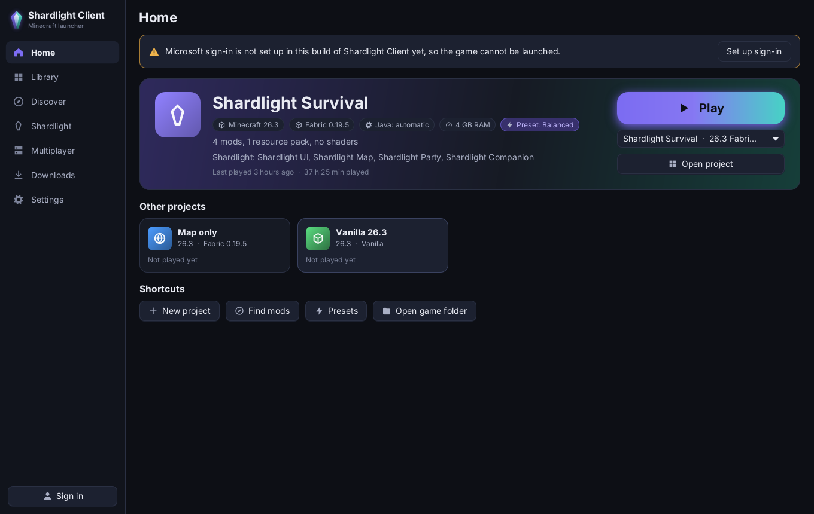
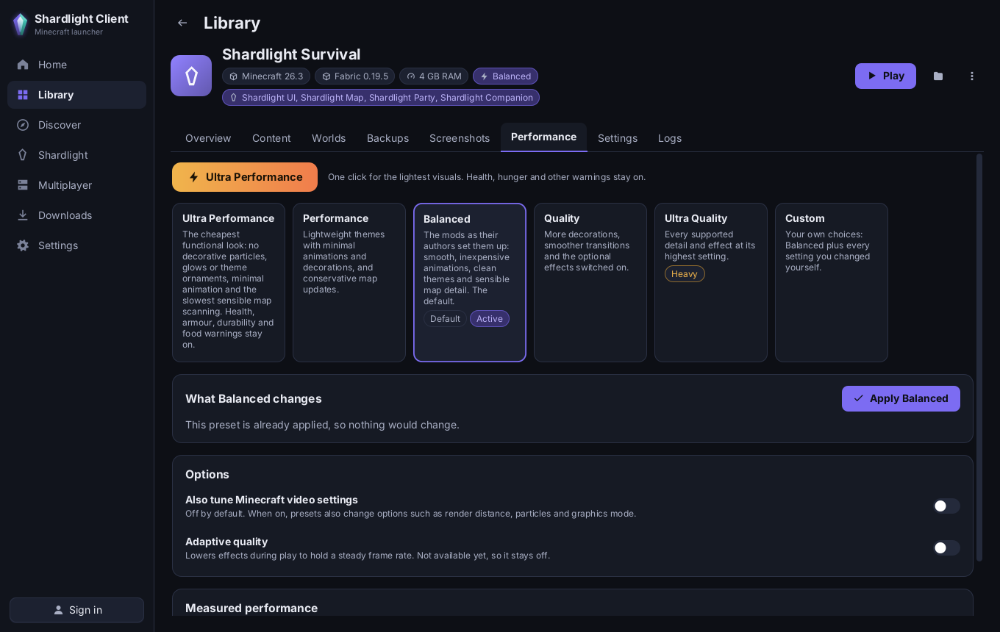
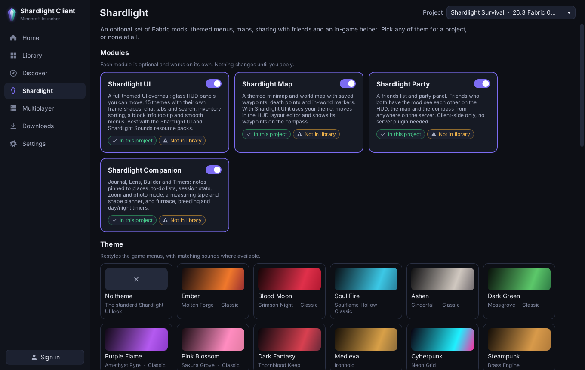
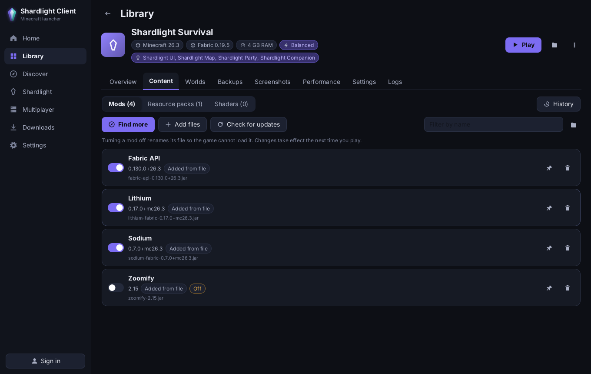

# Shardlight Client

A standalone desktop launcher for Minecraft: Java Edition. It installs and launches the game from
Mojang's own servers, keeps every setup in its own project folder, finds mods, resource packs and shaders
on Modrinth (and CurseForge, with a key), and puts frame rate first: every project starts on the
**Balanced** preset, and **Ultra Performance** is one click away.

The four Shardlight mods (UI, Map, Party, Companion) and their 15 theme packs are optional. The launcher
works without any of them, and a project only gets the modules you pick for it.

> **Status: 0.1.0 preview.** The launcher builds, runs and is covered by 578 automated tests, but it
> has not launched a real game yet. Signing in needs an Azure app that Microsoft has approved for
> Minecraft (see [Sign-in](#sign-in)), and that approval is not in place. See
> [docs/TESTING.md](docs/TESTING.md) for what has and hasn't been checked.



## What it does

| Area | What you get |
|---|---|
| **Projects** | One folder per setup, with its own Minecraft version, mod loader, mods, packs, worlds, options, Java and memory. New project wizard with templates, duplicate, rename, archive to the trash and restore, import and export (`.zip`, Modrinth `.mrpack`, CurseForge zip). Nothing mutable is shared between projects. |
| **Game installs** | Minecraft versions, libraries, natives and assets from Mojang, each file checked by SHA-1, downloaded once and shared by every project. Repair re-checks a project's files. Java runtimes come from Mojang, or you pick one on your computer. |
| **Mod loaders** | Fabric and Quilt through their metadata servers; Forge and NeoForge through their official installers (experimental, see [docs/SUPPORT_MATRIX.md](docs/SUPPORT_MATRIX.md)). |
| **Discover** | Search Modrinth for mods, modpacks, resource packs and shaders, filtered to the project's version and loader. Installs pull in required dependencies, show what will change first, and warn about conflicts and wrong versions. CurseForge works when the build or you supply an approved API key; files whose authors block third-party downloads open on the website instead. |
| **Content** | Turn mods on or off for the next launch, update, pin, remove, and roll back from the change history. Resource pack order, shaders, and duplicate or missing-dependency warnings. |
| **Presets** | Ultra Performance, Performance, **Balanced (default)**, Quality, Ultra Quality and Custom. A preset changes only the documented settings of the Shardlight mods installed in that project, shows what it will change before it does, and keeps your Custom overrides. Changing Minecraft's own video options is a separate opt-in. |
| **Shardlight** | Pick any of the four modules and one of 15 themes per project. The launcher installs only what you pick, plus Fabric API, and removes it cleanly when you turn it off. |
| **Worlds and backups** | Back up a world or a whole project, restore a backup (a safety backup of whatever it replaces is made first), and move worlds to the trash instead of deleting them. |
| **Playing** | Launch with the right Java, arguments and memory, watch the game's log live, track play time, and explain crashes in plain words with a fix where one is known. The diagnostics zip for bug reports masks tokens, your player name, home folder and server addresses, leaves out account files, worlds and screenshots, and is never uploaded. |
| **Multiplayer** | Each project's server list (read and written in the game's own `servers.dat`), with ping, player count and the server's message. |
| **Accounts** | Microsoft sign-in in your browser (device code). The launcher never sees your password; tokens live in the operating system's secret store. Game ownership is checked; there is no offline or cracked mode. |
| **Updates** | Optional, signed update checks. The launcher downloads a new version and verifies it, but never installs anything without you. |

Every page has light and dark themes, a reduced-motion switch, keyboard focus rings and a UI scale.
The launcher runs nothing in the background when its window is closed.

<table><tr>
<td></td>
<td></td>
</tr><tr>
<td></td>
<td>Screenshots use the sample data the <code>--capture</code> mode creates, so the mods and play times
in them are made up.</td>
</tr></table>

## Getting it

Builds come from GitHub Actions on every push. Open the latest successful
[Build run](https://github.com/Janxirus/Shardlight_Client/actions/workflows/build.yml) and download:

| File | For | Needs |
|---|---|---|
| `ShardlightClient-msi-…` | Windows installer | nothing else; Java is included |
| `ShardlightClient-windows-x64-…` | Windows app folder, no installer | nothing else; Java is included |
| `ShardlightClient-portable-…` | Windows, Linux and macOS | Java 21 or newer on the computer |

Release builds are made by hand from `main` and published as GitHub releases with checksums; see
[docs/RELEASING.md](docs/RELEASING.md).

**Portable zip.** Unzip it anywhere and run `ShardlightClient.bat` (Windows) or `./shardlight-client.sh`
(Linux, macOS). The script looks for Java 21+ in `SHARDLIGHT_JAVA`, `JAVA_HOME`, the official Minecraft
launcher's runtimes (Windows) and `PATH`. Add `--data-dir <folder>` to keep all data next to the
launcher, for example on a USB drive.

## Sign-in

Minecraft accounts sign in through Microsoft. A launcher can only do that with an Azure application id
that Microsoft has approved for Minecraft's services, and there is deliberately no id built in. Until the
distributor registers one, the launcher shows "Microsoft sign-in is not set up" and can install, organise
and prepare projects but not start the game. [docs/SIGN_IN.md](docs/SIGN_IN.md) walks through
registering the app, asking for access and configuring the id.

## Where your data lives

| System | Folder |
|---|---|
| Windows | `%APPDATA%\ShardlightClient` |
| macOS | `~/Library/Application Support/ShardlightClient` |
| Linux | `$XDG_DATA_HOME/shardlight-client`, or `~/.local/share/shardlight-client` |

`--data-dir`, the `shardlight.home` Java property or the `SHARDLIGHT_HOME` environment variable moves
it. Settings > Storage shows the folder and opens it. Uninstalling the launcher never deletes this folder,
so your worlds stay.

## Building from source

You need JDK 21. Everything else comes through the Gradle wrapper.

```
./gradlew build                               # compile, run every test, build the jars
./gradlew :launcher-app:run                   # start the launcher
./gradlew :launcher-app:run --args="--data-dir build/dev-data"   # with a throwaway data folder
./gradlew :launcher-app:portableZip           # the portable zip
./gradlew :launcher-app:jpackageImage         # app folder with its own Java (on the target OS)
./gradlew :launcher-app:jpackageInstaller     # Windows MSI (needs WiX Toolset 3 on PATH)
```

Command line options: `--data-dir PATH`, `--page home|library|discover|shardlight|multiplayer|downloads|settings`,
and `--capture DIR` (with `--capture-size WxH`), which opens every page, saves a PNG of each and exits.

A distributor's build can carry four optional values: the Azure client id, a CurseForge API key, and the
update manifest URL and public key. They come from Gradle properties or environment variables at build
time and never from files in the repository; see [docs/RELEASING.md](docs/RELEASING.md).

## More

- [CHANGELOG.md](CHANGELOG.md): what changed in each version
- [docs/ARCHITECTURE.md](docs/ARCHITECTURE.md): how the code is organised
- [docs/SUPPORT_MATRIX.md](docs/SUPPORT_MATRIX.md): systems, Java, Minecraft versions and loaders
- [docs/TESTING.md](docs/TESTING.md): what the tests cover and what still needs a person
- [docs/SIGN_IN.md](docs/SIGN_IN.md) and [docs/RELEASING.md](docs/RELEASING.md): distributor setup
- [CONTRIBUTING.md](CONTRIBUTING.md) and [SECURITY.md](SECURITY.md)

## License

All Rights Reserved; free to download and use, not open source. See [LICENSE](LICENSE).

Minecraft is a trademark of Mojang Synergies AB. Shardlight Client is not an official Minecraft product
and is not approved by or associated with Mojang or Microsoft.
