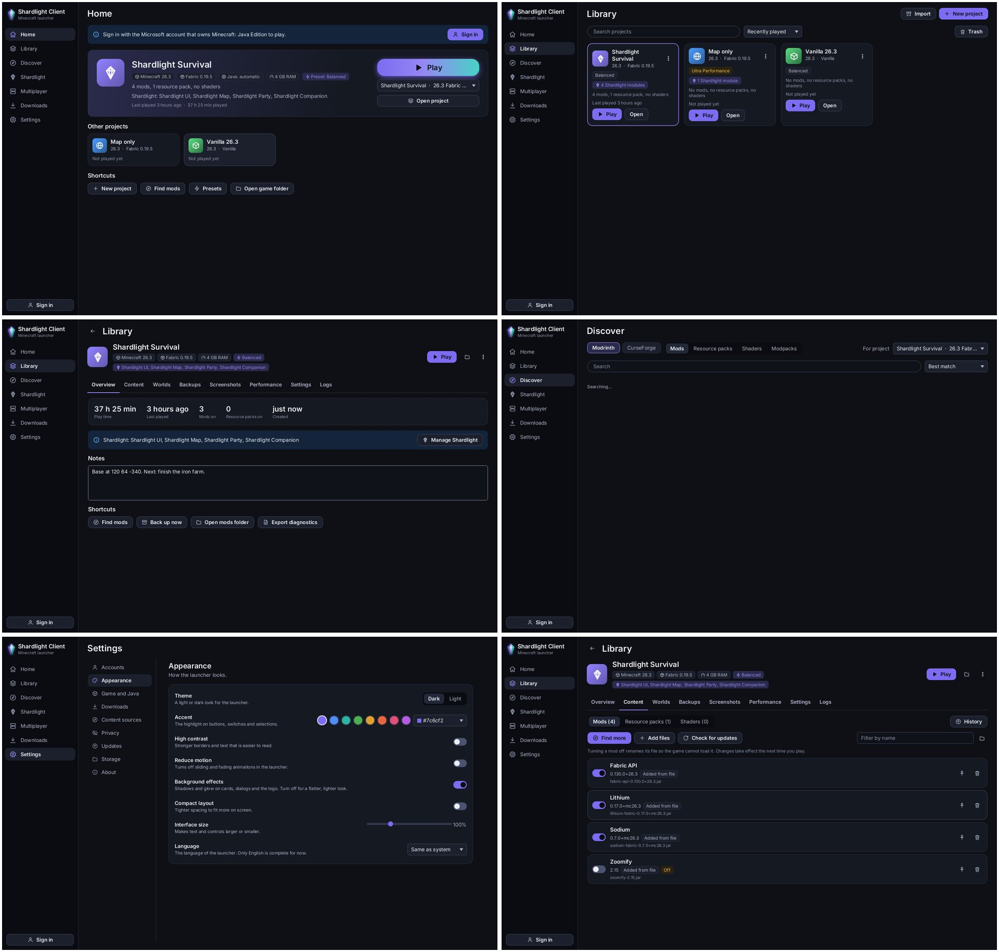
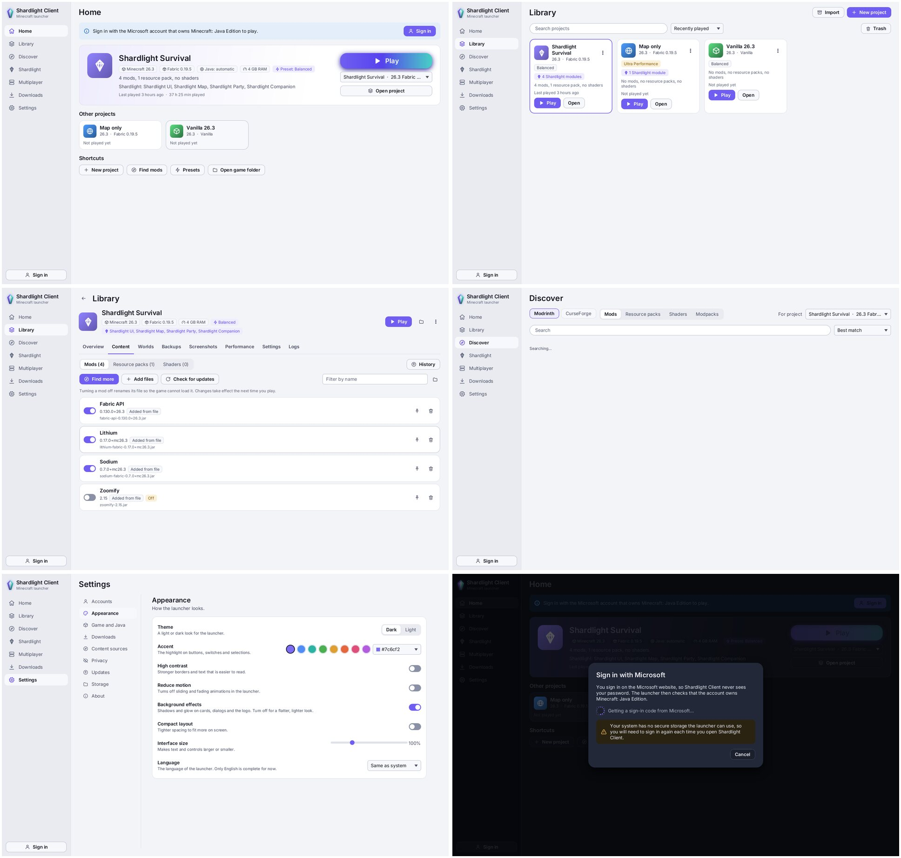
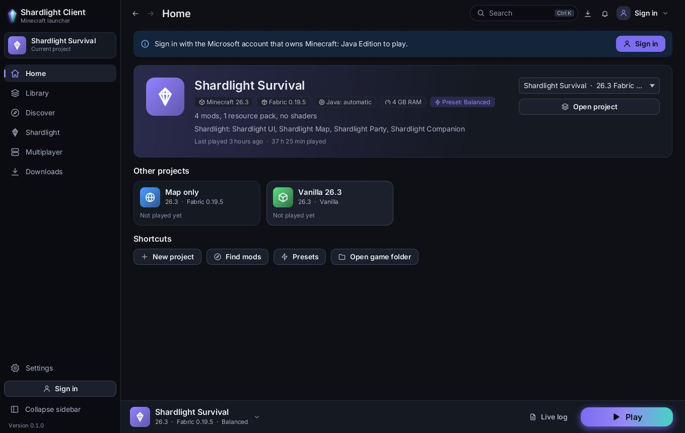
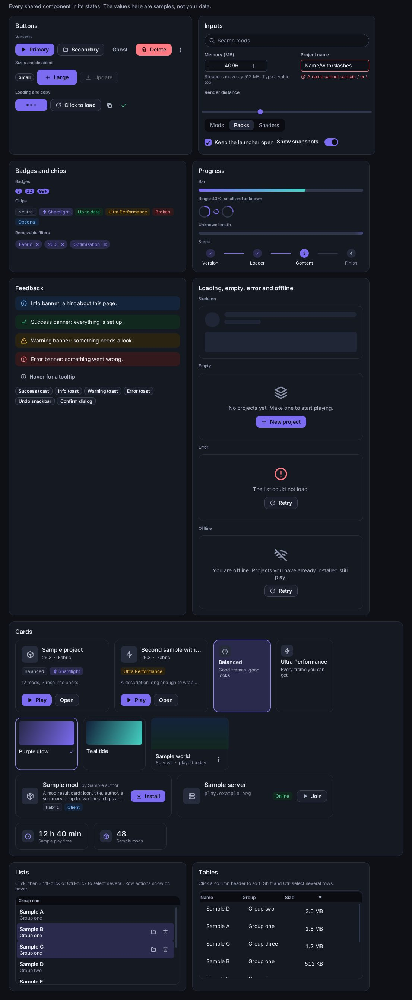

# Shardlight Client design system

How the launcher looks and how to style anything new. The code lives in `launcher-app`:

| What | Where |
| --- | --- |
| Colour tokens, type, spacing, shapes, every control | `src/main/resources/app/shardlight.css` |
| Accent ramp and contrast maths | `ui/DesignTokens.java` |
| Theme switching (dark, light, high contrast, compact, accent, size) | `ui/ThemeManager.java` |
| Fonts | `ui/Fonts.java`, `src/main/resources/app/fonts/` |
| Animation | `ui/Motion.java` (Reduce motion flag in `ui/UiSettings.java`) |
| Icons | `ui/Icons.java` |
| Shared widgets (buttons, cards, chips, banners, setting rows) | `ui/UiKit.java`, `ui/ToggleSwitch.java`, `ui/Overlay.java` |
| Components (fields, cards, lists, progress) | `ui/Fields.java`, `ui/Cards.java`, `ui/Lists.java`, `ui/ProgressRing.java`, `ui/Shimmer.java`, `ui/StepProgress.java` |
| The window frame (sidebar, top bar, history, Play bar, palette) | `ui/Shell.java`, `ui/TopBarTools.java`, `ui/PlayBar.java`, `ui/CommandPalette.java`, `ui/SidebarProject.java` |
| Windows title bar and taskbar progress | `ui/WindowsChrome.java`, `ui/TaskProgress.java` |
| Component gallery (every component in every state) | `pages/GalleryPage.java`, open with Ctrl+K "gallery" or `--page gallery` |
| Contrast test | `src/test/java/.../ui/DesignTokensContrastTest.java` |




## Rules

1. Use tokens and style classes, never raw colours or sizes in Java. If something new needs a colour,
   add a token to `.root` and `.root.light` in the stylesheet and a pair to the contrast test.
2. Sizes are in `em` so the interface size setting scales them (1 em = 14 px at 100%).
3. Spacing and sizes sit on a 4 px grid. Corner radii come from the shape scale.
4. An element has a border or a shadow, never both.
5. Every interactive thing has hover, pressed, focused (`:focus-visible`) and disabled states.
6. Only opacity, translation and scale are animated, always through `Motion`.
7. Every visible string is a key in `src/main/resources/i18n/ui.properties`.

## Colour tokens

Tokens are JavaFX looked-up colours defined on `.root` (dark, the default) and `.root.light`. Light is
designed on its own, not as an inverted dark: cool greys, white cards, deeper status colours.

### Surfaces (five levels)

| Token | Dark | Light | Use |
| --- | --- | --- | --- |
| `-sl-sunken` | `#0a0c11` | `#e9ebf1` | Wells: sidebar, code blocks, segmented controls, table headers |
| `-sl-bg` | `#0e1016` | `#f3f4f8` | The window background |
| `-sl-surface` | `#151922` | `#ffffff` | Cards, tiles, lists |
| `-sl-raised` | `#1b202c` | `#f7f8fb` | Controls (buttons, combo boxes), hovered cards, the selected nav item |
| `-sl-overlay-bg` | `#222838` | `#ffffff` | Floating things: modals, menus, popups, toasts |

Fills and overlays for states: `-sl-fill` (hover fill, icon boxes), `-sl-fill-strong` (pressed fill,
tracks), `-sl-field` (inside text fields and check boxes), `-sl-hover` and `-sl-pressed` (translucent, so
they work on any surface).

### Text (three levels) and borders (two levels)

| Token | Dark | Light | Use |
| --- | --- | --- | --- |
| `-sl-text` | `#eceef5` | `#141722` | Primary text |
| `-sl-text-2` | `#aeb4c8` | `#474d63` | Secondary text, default icons (`.muted`) |
| `-sl-text-3` | `#8b92a9` | `#5f667d` | Captions, placeholders, hints (`.faint`) |
| `-sl-border` | `#262c3c` | `#dde0e8` | Card and divider lines |
| `-sl-border-strong` | `#3b4359` | `#b8bfcf` | Control outlines, hovered cards |

All three text levels reach 4.5:1 on all five surfaces in both themes.

### Accent ramp

Computed by `DesignTokens.ramp(accent, light)` from the accent setting and set inline on the root by
`ThemeManager.apply`, so changing the accent recolours every one of these at once. The stylesheet holds
the values for the default purple (`#7C6CF2`).

| Token | Use |
| --- | --- |
| `-sl-accent-subtle` | Tinted background: selected rows, accent chips, selected toggles, the hero gradient |
| `-sl-accent-hover` | Accent fill under the pointer |
| `-sl-accent` | Accent fill: primary buttons, switches, checked boxes, progress |
| `-sl-accent-pressed` | Accent fill while pressed |
| `-sl-accent-text` | Text and icons on the three accent fills |
| `-sl-accent-fg` | Accent-coloured text, links and icons on surfaces; also the focus ring (`-sl-focus`) |

How it is built: the chosen colour is kept if it already works; otherwise its HSL lightness moves the
shortest distance until text on it reaches 4.5:1 (dark text on a lighter fill or white text on a darker
one) and the fill reaches 3:1 against the surfaces. Hover and pressed move further away from the text
colour, so they never lose contrast. `-sl-accent-fg` is moved until it reaches 4.5:1 on every surface.
`-sl-accent-2` (teal `#46d3c4`) is the fixed second brand colour used only in the Play button and
progress gradients.

### Status

Each has a strong variant (text, icons, fills) and a subtle one (backgrounds). Strong text reaches 4.5:1
on every surface and on its own subtle background.

| Token | Dark | Light |
| --- | --- | --- |
| `-sl-success` / `-sl-success-subtle` | `#4ad295` / `#11281f` | `#157a4a` / `#e2f4ea` |
| `-sl-warning` / `-sl-warning-subtle` | `#f2b84f` / `#2b2312` | `#8a5a00` / `#fbf0d9` |
| `-sl-danger` / `-sl-danger-subtle` | `#ff7b84` / `#33181c` | `#c0303d` / `#fde7e9` |
| `-sl-info` / `-sl-info-subtle` | `#6cb4ff` / `#13243b` | `#1f66c2` / `#e4eefb` |

Danger buttons use `-sl-on-danger` text and `-sl-danger-hover`.

### Small pieces and old names

`-sl-tooltip-bg` / `-sl-tooltip-text`, `-sl-knob` and `-sl-switch-off` (switches), `-sl-icon` (see
Icons), `-sl-focus`. The names from before the design system still work: `-sl-bg-2` = `-sl-sunken`,
`-sl-surface-2` = `-sl-raised`, `-sl-surface-3` = `-sl-fill`, `-sl-shadow` = `-sl-shadow-2`,
`-sl-overlay` (= `-sl-scrim`) is the dimmed backdrop behind modals.

### High contrast

`.root.high-contrast` makes every text level primary text, makes borders clearly visible, and gives
floating surfaces (modals, menus, toasts, tooltips) a border instead of a shadow.

### Contrast test

`DesignTokensContrastTest` reads the stylesheet and checks, in dark, light and both high-contrast
variants: every text level and status colour on every surface (4.5:1), text on fills and subtle
backgrounds, text on danger and tooltips, the switch knob on its track (3:1), and the accent ramp for all
eight presets plus 200 random colours. It also checks that the stylesheet's default ramp matches what
`DesignTokens` computes. Add a pair whenever you add a token that text sits on.

## Type

Fonts are bundled and loaded at startup by `Fonts.load()`; if one fails the matching system font is
used. **Inter** for the interface, **Inter Tabular** (Inter with tabular figures, so digits line up and
don't jiggle) for numbers, **JetBrains Mono** for logs and code. JavaFX only asks for regular or bold, so
the bold slot holds Inter's SemiBold (600): `-fx-font-weight: bold` renders semibold.

| Class | Size | At 100% | Weight | Use |
| --- | --- | --- | --- | --- |
| `.display` | 2.286em | 32 px | semibold | Hero titles |
| `.h1`, `.page-title` | 1.714em | 24 px | semibold | Page titles |
| `.h2`, `.modal-title` | 1.429em | 20 px | semibold | Section titles, dialog titles |
| `.h3` | 1.143em | 16 px | semibold | Card titles, group headings |
| `.body` (default) | 1em | 14 px | regular | Everything else |
| `.small` | 0.857em | 12 px | regular | Secondary lines, chips, tooltips |
| `.caption` (`.tiny`) | 0.786em | 11 px | regular | Labels under numbers, eyebrows |
| `.mono` | 0.929em | 13 px | regular | Paths, versions, logs (`.code-block`, `.log-view`) |

Use `.tabular` on any label showing a size, speed, count or time (`.stat-value`, `.progress-text` and
`.table-cell.numeric` get it automatically). `.strong` makes text semibold; `.muted` and `.faint` pick
the second and third text levels.

## Spacing

A 4 px grid. Use these steps only (em at 100%):

| px | 4 | 8 | 12 | 16 | 24 | 32 | 48 |
| --- | --- | --- | --- | --- | --- | --- | --- |
| em | 0.286 | 0.571 | 0.857 | 1.143 | 1.714 | 2.286 | 3.429 |

Cards pad 16, pages pad 24 at the sides, items in a card are 12 apart, sections on a page 16 apart.
Java gaps (`new HBox(8, ...)`) should use the px column until those layouts move to CSS.

## Shape

| Radius | px | em | For |
| --- | --- | --- | --- |
| Small | 6 | 0.429 | Text fields, combo boxes, chips, tooltips, menu items |
| Medium | 10 | 0.714 | Buttons, nav items, banners, menus, segmented controls |
| Large | 14 | 1 | Cards, tiles, lists, toasts, the hero |
| Extra large | 20 | 1.429 | Modals |

Switches, sliders, progress bars and search fields are fully rounded.

## Depth

Three shadow levels, as classes and as the colours `-sl-shadow-1/2/3`:

| Class | For |
| --- | --- |
| `.elevation-1` | Selected segment, slider thumbs, tooltips |
| `.elevation-2` | Raised cards (`.card.raised`), menus, popups, toasts |
| `.elevation-3` | Modals |

Never a border and a shadow on one element: `.card.raised` drops its border. With Background effects off
(`.root.no-effects`) shadows are removed and raised cards get their border back.

## Motion

Every animation goes through `ui/Motion.java`.

| Speed | Duration | For |
| --- | --- | --- |
| `Motion.Speed.FAST` | 120 ms | Hover and press, switch knobs |
| `Motion.Speed.MEDIUM` | 200 ms | Panels, popovers, toasts, the modal backdrop |
| `Motion.Speed.SLOW` | 320 ms | Pages and modals |

`Motion.ENTER` is ease-out (things appearing), `Motion.EXIT` is ease-in (things leaving). Helpers:
`enter(node, speed, dy)` fades in while rising `dy` px (pages and toasts use `Motion.ENTER_OFFSET`, 8 px),
`fadeIn`, `exit(node, speed, done)`, `pop(node, speed, from)` (modals grow from 0.96), `moveX`, `moveY` (the
sidebar pill), `lift(node)` (cards rise 2 px on hover and keyboard focus), `pulse` (skeletons, loading dots,
an unknown progress ring) and `sweepX` (the shimmer bar). With Reduce motion on, moves and scales are
instant, fades take 80 ms and endless animations hold still. Never use `FadeTransition` and friends
directly.

## Icons

`Icons.of(Icons.NAME, size)` returns a node (the app uses sizes such as 13, 16, 18 and 40, in pixels at 100%;
icons grow with the interface size setting like text does). All icons are drawn on a
24-unit grid as outlines with a 2-unit stroke and round caps and joins, inside 2.5 to 21.5, with corner
radii of 1 to 2 units. Play, Stop and More are also filled. A clear 24x24 square keeps every glyph on the
same grid, so icons line up with each other.

The colour comes from the looked-up colour `-sl-icon`, which any ancestor can set; the nearest one wins:

```css
.button.primary { -sl-icon: -sl-accent-text; }
.banner.warning { -sl-icon: -sl-warning; }
```

Helper classes: `.accent-icon`, `.success-icon`, `.warning-icon`, `.danger-icon`, `.info-icon`, `.muted`,
`.faint`. To add an icon, draw it on the same grid with the same stroke, add the constant to `Icons`, and
add it to `SOLID` only if it must be filled.

Set: HOME, LIBRARY, DISCOVER, SHARD, SERVERS, DOWNLOAD, GEAR, PLAY, STOP, PLUS, SEARCH, FILTER, SORT, GRID,
LIST, SLIDERS, FOLDER, TRASH, MORE, CLOSE, BACK, REFRESH, EXTERNAL, COPY, PIN, CHECK, WARNING, INFO,
ERROR, UPDATE, CLOCK, SHIELD, BOLT, USER, PACKAGE, CUBE, IMAGE, ARCHIVE, PALETTE, GAUGE, SPARKLE, LOGS,
STAR, HEART, EYE_OFF, KEY, WORLD, CPU, MEMORY, WIFI, WIFI_OFF, FORWARD, CHEVRON_RIGHT, CHEVRON_DOWN, MINUS,
SIDEBAR, BELL, COMMAND.

## Controls

Controls draw their outline and focus ring with background layers (`-fx-background-color: outline,
fill; -fx-background-insets: 0, 1`), so focusing never moves anything. The focus ring is 2 px of
`-sl-focus` and shows on keyboard focus only (`:focus-visible`); text fields show it whenever focused.

| Control | How to get it | Notes |
| --- | --- | --- |
| Secondary button | `UiKit.button(...)` or a plain `Button` | Raised fill, strong outline |
| Primary button | `UiKit.primary(...)`, class `primary` | One per view |
| Ghost button | class `ghost` | Toolbars, rows |
| Danger button | class `danger` | Destructive confirmations only |
| Icon-only button | `UiKit.iconButton(icon, name, action)` | Ghost, with tooltip and accessible name |
| Sizes | classes `small`, `large` | |
| Text field | `TextField`; `search-field` for pill search; `error` for invalid input | |
| Combo, choice, spinner, colour picker | the JavaFX control | Popups float on `-sl-overlay-bg` |
| Check box, radio button | the JavaFX control | Accent fill when checked |
| Switch | `new ToggleSwitch(value)` | Use inside `UiKit.settingRow` |
| Slider | `Slider` | Accent thumb |
| Tabs | `TabPane` | Underline in `-sl-accent-fg` |
| Segmented | `UiKit.segmented(...)` | For 2 to 4 options |
| Lists and tables | `ListView`, `TableView` | Selected row uses `-sl-accent-subtle` |
| Chips | `UiKit.chip(text, variant)` | Variants: `accent`, `success`, `warning`, `danger`, `info` |
| Banners | `UiKit.banner(kind, text)` | Subtle status background, strong icon |
| Tooltips, context menus | `UiKit.tooltip`, `ContextMenu` | 400 ms delay. Menu items can add class `danger` |

## The window frame



- **Window.** The native window stays. On Windows 10 and 11 `WindowsChrome.titleBar` switches the title bar to
  dark or light (`DWMWA_USE_IMMERSIVE_DARK_MODE`) and on Windows 11 sets the caption and caption-text colours to
  `-sl-bg` and `-sl-text`; `AppContext.applyTitleBar` reruns it whenever the theme changes. Other systems:
  nothing happens. Long tasks report to `TaskProgress`, which shows their average on the Windows taskbar button.
- **Sidebar.** 240 px with labels, 72 px with icons only (Ctrl+B or the button at the bottom; remembered in
  `appearance.sidebarCollapsed`). The current project is pinned at the top with its art. An accent pill
  (`.nav-pill`) slides to the active item. `Shell.setBadge(id, n)` shows a count (Downloads: active downloads,
  Settings: a launcher update). Settings, the account chip and the version sit at the bottom.
- **Top bar.** 52 px, no divider: back and forward, breadcrumbs (pushed pages appear after the page that opened
  them, and earlier crumbs are links), the page's own `actions()`, then the search box (opens the palette),
  the downloads indicator (ring while downloading), the notifications bell and the account switcher.
- **History.** Back and forward with the buttons, Alt+Left / Alt+Right and the mouse's side buttons. Escape goes
  up one breadcrumb. A page shown again by going back keeps its scroll position; a page opened from the sidebar
  starts at the top. Pages fade and rise 8 px as they enter.
- **Command palette.** Ctrl+K. `CommandPalette` fuzzy-matches (`Fuzzy.score`) projects, installed content,
  pages, settings sections and actions (New project, Open logs, Switch to Ultra Performance, theme, sidebar,
  diagnostics...). Up, Down, Enter, Escape. To add an action, add a `Command` in `CommandPalette.commands()`.
- **Ctrl+F** focuses the page's `SearchField` (or a `.search-field`), else opens the palette.
- **Play bar.** On every page: the selected project (click to switch, right-click for its actions), version,
  loader and preset, Live log, and the Play button. `PlayFlow.state(projectId)` gives the phase: idle,
  preparing, downloading (with a percentage and a thin bar along the top), launching, running (play time,
  click to stop) and error (click to retry, "What went wrong" for details). Starting a game no longer opens a
  progress dialog; clicking while it gets ready cancels.
- **Notifications.** One toast system in `Overlay`: `toast(kind, text, actions...)` with kind success, info,
  warning or error (`danger` still works), optional `Overlay.Action`s (Undo, Open, Retry), at most three
  stacked above the Play bar, kept while hovered. `undo(text, action)` is the undo snackbar. Every toast is
  kept in `history()`, which the bell shows for the session.
- **Popovers.** `Overlay.popover(anchor, content, alignRight)` floats a `.popover` under a control; it closes
  on a click outside, Escape, navigation or a dialog. Used by the bell, the account switcher and the project
  switcher. Popovers live in the window (not separate windows), so they follow the theme and `--capture` sees
  them.

## Components

Build pages from these. All of them are shown, in each state, in the component gallery.



| Component | API | Notes |
| --- | --- | --- |
| Loading button | `UiKit.loading(button, true)` | Three pulsing dots replace the label; the width stays; clicks are ignored |
| Disabled with a reason | `UiKit.explained(control)` in the layout, then `UiKit.disable(control, reason)` | The tooltip says why; `null` enables it |
| Copy button | `UiKit.copyButton(text, name)` or `UiKit.copied(button)` | Check mark for 1.5 s |
| Search field | `new Fields.SearchField(prompt)` | Clear button, Escape clears, Ctrl+F focuses it |
| Number field | `new Fields.NumberField(min, max, step, value, name)` | Steppers, arrow keys, Page Up/Down; `errorProperty()` |
| Slider with value bubble | `new Fields.ValueSlider(min, max, value, format, name)` | Bubble over the thumb on hover, drag and focus |
| Labelled field, inline error | `new Fields.Field(label, control, help)`, `setError(msg)` or `bindError(...)` | Error replaces the help line and marks the control |
| Segmented control | `UiKit.segmented(options, selected, onSelect)` | 2 to 4 options |
| Cards | `Cards.project`, `modResult`, `preset`, `theme`, `server`, `world`, `stat`; `Cards.onOpen(card, action)` | 2 px hover lift; long text is one line; actions on the bottom edge |
| Lists | `Lists.rows(list, render, actions)`, `Lists.stickyHeader(list, groupOf)` | Virtualised, Shift/Ctrl multi-select, row actions on hover |
| Tables | `Lists.table(table, placeholder)`, `Lists.column`, `numberColumn`, `actionsColumn` | Sortable headers that stay put, multi-select |
| Badges | `UiKit.badge(n)`, `UiKit.setBadge(label, n)` | 0 hides it, over 99 shows 99+ |
| Filter chips | `UiKit.filterChip(text, onRemove)` | |
| Progress | `UiKit.progress(f)`, `new ProgressRing(f)` (`small`; negative = unknown), `new Shimmer()`, `new StepProgress(steps, current)` | |
| Tooltip, banner, confirm, undo | `UiKit.tooltip`, `UiKit.banner`, `Overlay.confirm`, `Overlay.undo` | |
| Skeleton | `UiKit.skeleton("line" / "short" / "block" / "circle")`, `UiKit.skeletonCard()` | Pulses while loading |
| Empty state | `UiKit.empty(illustration, sentence, action)` | One sentence, one action |
| Error and offline | `UiKit.errorState(message, retry)`, `UiKit.offlineState(retry)` | Both have Retry |

### Pieces added in Part 3

| Piece | API | Notes |
| --- | --- | --- |
| Project art | `ProjectArt.of(project, dir, w, h, radiusEm)` | The project's own picture as a cover, or art drawn from the name and the template colour, so no two projects look alike. Same project, same art |
| Play button | `PlayButton.of(ctx, project, "large")` | Play, Cancel or Stop by the launch phase; the one main action on Home, the project page and the Play bar |
| Tab strip | `new TabStrip(labels, initial, onSelect)` | Underline slides with `Motion.slideBar`; Left and Right move between tabs; the page owns the content |
| Masonry | `MasonryPane.add(node, ratio)` | Shortest-column layout for the screenshot gallery |
| Player head | `PlayerHead.of(account, size)` | The face and hat of the account's own skin; only `textures.minecraft.net`, always over https |
| Log lines | `LogLines.parse` (`log-error`, `log-warn`, `log-info`, `log-debug`) | Level colours are tokens; stack traces take the level of their error |
| Library view | `LibraryView` in `launcher-core` | Sort, filter, folders and drag order as plain logic with tests; saved in `settings.library` |

Text and controls drawn on art use `-sl-on-art` with the translucent `-sl-art-chip` and `-sl-art-scrim-*`
tokens (the same in dark and light, because the art is a picture; a test checks them over pure white art).
Add the class `on-art` to a label, chip or button that sits on art, and `art-action` to a button that
floats over it.

Layout classes replace numbers in Java: `stack` and `stack-tight` (vertical gaps), `button-row`, `stat-row`,
`tab-bar`, `page-actions`, `tab-body`, and `page-column` (the 80em reading width of Home and Library).
Spacing set with a constructor argument is not overridden by the stylesheet, so give containers a class
instead of `new VBox(10)`.

Images: show a placeholder in `-sl-fill` and fade the picture in when it arrives (`RemoteImage`). Right-click
menus offer the same actions as the visible buttons (project tiles, the pinned project, the Play bar).

### Pieces added in Part 4

| Piece | API | Notes |
| --- | --- | --- |
| Dialog frame | `Overlay.modal(title, body, buttons...)`, `Overlay.fillActions` | Title, body, then one footer: Cancel on the left, the main action on the right. Esc closes (give the button `setCancelButton(true)`). The first `primary` button is the default, so Enter confirms |
| Danger dialog | `Overlay.confirm(message, details, danger)` | The red `modal-lost` panel says what is lost; the button uses the danger style. Enter never confirms a danger dialog and the focus starts on Cancel, so a stray key cannot delete anything |
| Disclosure | `Disclosure.of(title, content)` | A collapsed "Advanced" part: header with a chevron, content slides open. Used by the new-project wizard and a download's file list |
| Split Install button | `InstallButton` | Main button shows the state (Install, Installing, Installed, Update); the arrow opens versions. Class `primary-split` when the main part is primary |
| Step header | `StepProgress` | Numbered steps joined by a line; done steps get a tick. The new-project wizard uses three: template, basics, review |
| Ping bars, MOTD | `PingBars`, `MotdText` | Four bars by latency; the MOTD is drawn from Minecraft colour codes mapped to readable colours in both themes (a test checks contrast) |
| Settings search | `SettingsPage` | Every setting is registered with a title and keywords; the search jumps to the section, scrolls to the row and marks it with `setting-found` for three seconds. Each change applies at once and shows an Undo toast |
| Crash screen | `CrashScreen.show` | The most likely cause in plain words, the fix button from the crash analysis, the other findings collapsed, then Open log and Export diagnostics |

**JavaFX CSS limits.** There are no sibling combinators (`+`, `~`) and no `:not`, `:is`, `:where`,
`:nth-child` or `:last-child`. A selector the parser cannot read makes it drop the rest of the stylesheet,
so everything after it looks unstyled. Use a style class instead (`ruled`, `primary-split`).
`StylesheetTest` fails the build on these selectors.

## Styling a new view

1. Build it from `UiKit` pieces and JavaFX controls; give containers style classes (`card`, `page`,
   `banner`, your own class) instead of `setStyle`.
2. If it needs its own rules, add a short section near the end of `shardlight.css` (page-specific
   pieces go after the base controls so they win), using only tokens, the spacing steps and the radius
   scale.
3. New colours: add the token to `.root` and `.root.light` (and `.root.high-contrast` if text levels are
   involved), then add the text/background pair to `DesignTokensContrastTest`.
4. Numbers get `.tabular`; paths and versions get `.mono`.
5. Animate with `Motion` only.
6. Check it in the gallery and with `--capture` in dark and light, at 100% and a larger interface size, with high contrast
   and Reduce motion on, and with the keyboard alone.
